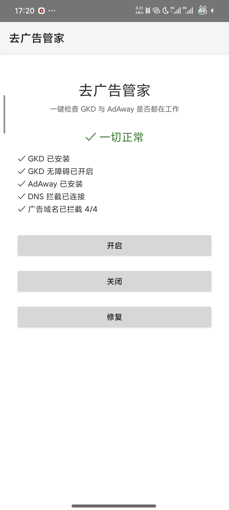
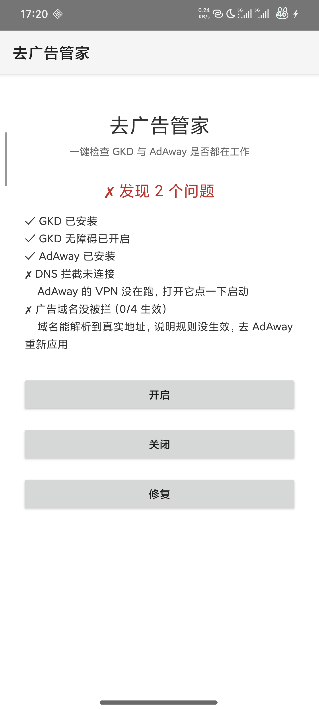
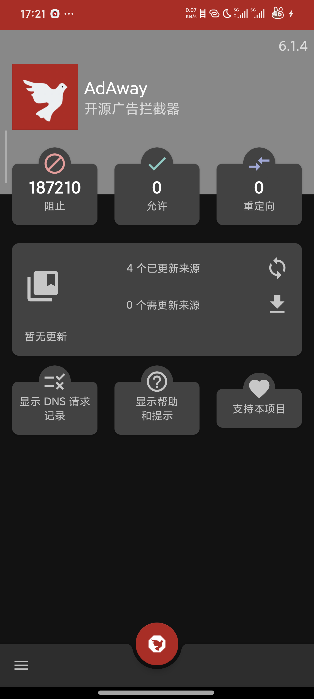

# 去广告管家（安卓 · 免 root）

一个只干一件事的小工具：**检查手机上的去广告链路有没有断，断了告诉你断在哪、该去点哪里。**


> 两个 Java 源文件、零第三方依赖。没有网络请求，不上传任何数据 ——
> 它只读本机的安装列表、系统设置和 DNS 解析结果。

---

## 为什么要它

手机去广告通常靠两套互不相干的机制：

| 机制 | 负责什么 | 断了的表现 |
|------|---------|-----------|
| **AdAway** | VPN 接管 DNS，让广告域名解析失败 | 广告位一直转圈，或者广告照常加载 |
| **GKD** | 无障碍读屏，自动点「跳过」 | 开屏广告倒计时照走，没人帮你点 |

两套机制任何一套断了，你看到的都是「还有广告」，但原因完全不同。

最常见的是**系统偷偷把无障碍关掉**（小米尤其容易），GKD 进程还活着、界面看着正常，实际已经读不了屏。手动排查要翻好几层设置。这个 App 就是把这件事变成点一下。

---

## 界面

<p align="center">
  
  
  
</p>

<p align="center">
  <sub>一键体检 → 定位问题 → 跳到该去的地方</sub>
</p>

主界面是一张体检单，每项后面直接写结论，出问题时直接给出下一步动作：

```
✗ DNS 拦截未连接
     AdAway 的 VPN 没在跑，打开它点一下启动
✗ 广告域名没被拦（0/4 生效）
    域名能解析到真实地址，说明规则没生效，去 AdAway 重新应用
```

> 中间那张图是真机实拍的故障现场：**AdAway 首页显示「已阻止 187210 次」，
> 看起来一切正常，但 `tun0` 根本没起来，广告域名照常解析。**
> 这正是这个 App 存在的理由 —— 计数器会骗人，真实解析不会。

---

## 三个按钮

- **开启** —— 按当前检测结果，把第一个没开的东西拉起来
- **关闭** —— 分别跳到 GKD 和 AdAway，让你亲手关掉
- **修复** —— 重新体检一遍，只处理出问题的那一段

## 检测什么

```
✓ GKD 已安装
✓ GKD 无障碍已开启        ← 读系统设置，判断总开关 + 服务是否在启用列表
✓ AdAway 已安装
✓ DNS 拦截已连接          ← 查系统里有没有 VPN 类型的网络
✓ 广告域名已拦截 4/4      ← 真的去解析广告域名，这是唯一可靠的判据
```

最后一条最关键：前面几条都可能「看起来正常」，只有真的解析不出广告域名，才能证明拦截在工作。

检测时会先解析一个对照域名（`www.baidu.com`）确认网络是通的，否则断网会让所有域名都解析失败，误判成「全拦住了」。

---

## 为什么「修复」是跳转而不是自动改

普通 App 没有 `WRITE_SECURE_SETTINGS` 权限，改不了系统的无障碍开关；也不能替别的 App 启停 VPN。这是 Android 的安全边界，绕不过去。

所以这里的修复是**精准跳转**：检测出哪一段断了，直接把你送到那一页，并提示该点哪里。不假装已经修好。

如果以后要全自动，可以接 [Shizuku](https://github.com/RikkaApps/Shizuku)，用 adb 授权一次后就能直接改。

---

## 构建

```bash
# 需要 JDK 17 + Android SDK + Gradle 8.7
echo "sdk.dir=/你的/AndroidSDK/路径" > local.properties
gradle assembleDebug
# 产物：app/build/outputs/apk/debug/app-debug.apk
```

## 依赖的外部 App

- [AdAway](https://github.com/AdAway/AdAway)（开源，F-Droid / GitHub 有）
- [GKD](https://github.com/gkd-kit/gkd)（开源）

本 App 不替代它们，只是它们的体检工具。

---

## 关于作者

工科在读，写 Python 和 Android 小工具。

这个 App 的起因是：我自己手机上 AdAway 明明显示在跑，广告却回来了。
翻设置翻了半小时才发现是 VPN 隧道断了而进程还活着。
后来想明白 —— **「看起来正常」和「真的在工作」是两件事**，
所以这个 App 的核心判据不是查状态，是真的去 `InetAddress.getByName()` 解析广告域名。

**想加检测项、遇到问题、或者需要类似的小工具定制，欢迎开 [Issue](../../issues)。**

## 许可

MIT
